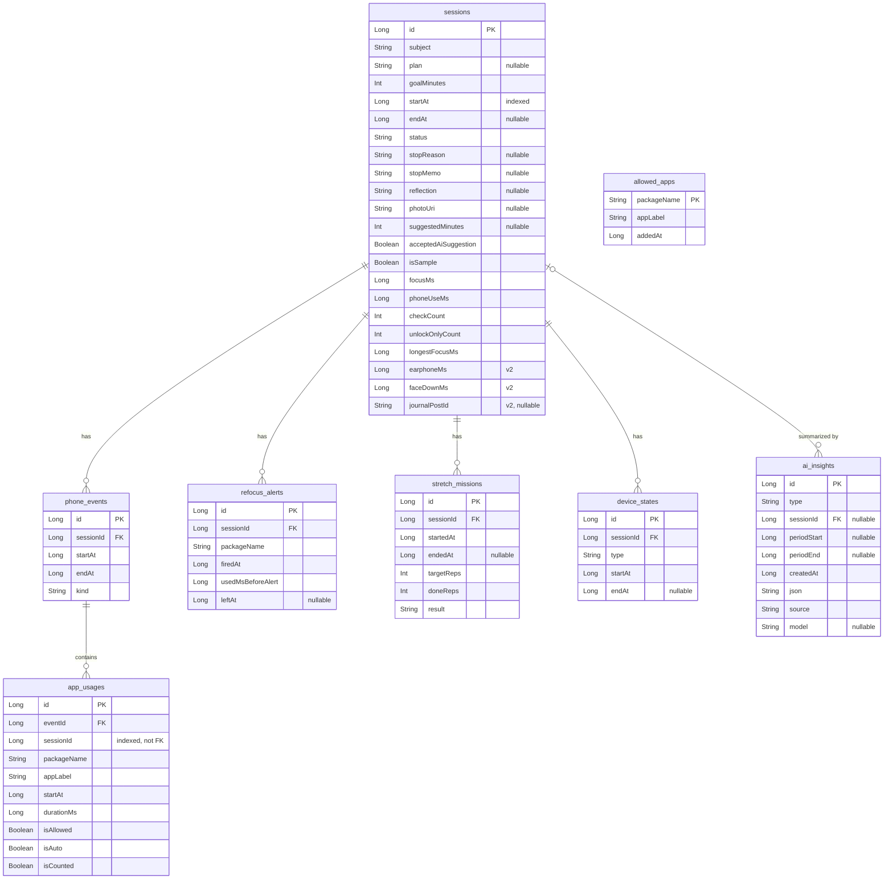

# FocusTrace — Room Schema (v2)

Owner: track A. Change entities only after updating this file.
Database version: **2**.

## Changes from v1
- New table `device_states` (earphones, face-down).
- `sessions`: new columns `earphoneMs`, `faceDownMs`, `journalPostId`.
- `COMPLETED` now always means the goal time was reached (auto-complete).
- Session API updated to match the code (see below), plus backup and restore through Firestore.
- Version 2 uses destructive migration in development: updating deletes local data on each device.

## Conventions
- Times: `Long` epoch ms. Durations: `...Ms`. Status/kind/type values: `String`.
- Day/week/month boundaries are computed in the device time zone.
- Child rows are deleted with their session (`onDelete = CASCADE`). Index every foreign key and `sessions.startAt`.

## ER diagram

## Tables

### `sessions` — one focus session
| Column | Type | Note |
| --- | --- | --- |
| `id` | Long PK auto | |
| `subject` | String | |
| `plan` | String? | one-line plan |
| `goalMinutes` | Int | |
| `startAt` | Long | |
| `endAt` | Long? | null while running |
| `status` | String | see Status below |
| `stopReason` | String? | `DISTRACTED` / `TIRED` / `INTERRUPTED` / `TASK_COMPLETED` / `OTHER` |
| `stopMemo` | String? | |
| `reflection` | String? | wrap-up note |
| `photoUri` | String? | completion photo location (C) |
| `suggestedMinutes` | Int? | AI-suggested length; null if AI suggestion not used |
| `acceptedAiSuggestion` | Boolean | whether the user accepted the AI suggestion |
| `isSample` | Boolean | demo sample data, kept out of real stats |
| `focusMs` | Long | summary, set by `endSession()` |
| `phoneUseMs` | Long | summary |
| `checkCount` | Int | summary |
| `unlockOnlyCount` | Int | summary |
| `longestFocusMs` | Long | summary |
| `earphoneMs` | Long | **v2.** summary, time with earphones connected |
| `faceDownMs` | Long | **v2.** summary, time with the phone face down |
| `journalPostId` | String? | **v2.** board post this session was saved to (Save to Journal) |

Summary columns stay 0 while `RUNNING`. For live values of a running session (e.g. widget), count its `phone_events` directly.

**Status**
| status | Meaning |
| --- | --- |
| `RUNNING` | In progress. Only one at a time |
| `COMPLETED` | Goal time reached. Set by `FocusService` with `endAt = startAt + goalMinutes` |
| `EARLY_STOP` | Ended by the user before the goal, with a reason |
| `UNFINISHED` | Closed without ending (app killed, new session started) |

### `phone_events` — one episode (unlock → screen off)
| Column | Type | Note |
| --- | --- | --- |
| `id` | Long PK auto | |
| `sessionId` | Long FK | |
| `startAt` | Long | `USER_PRESENT` time (or session start) |
| `endAt` | Long | screen off |
| `kind` | String | `CHECK` / `ALLOWED_ONLY` / `UNLOCK_ONLY` |

### `app_usages` — one app inside an episode
| Column | Type | Note |
| --- | --- | --- |
| `id` | Long PK auto | |
| `eventId` | Long FK | |
| `sessionId` | Long | for direct queries |
| `packageName` | String | |
| `appLabel` | String | name at save time |
| `startAt` | Long | clipped to unlock time |
| `durationMs` | Long | consecutive same app merged |
| `isAllowed` | Boolean | allow-list state at save time |
| `isAuto` | Boolean | reappeared on unlock |
| `isCounted` | Boolean | false = pass |

### `device_states` — earphones and face-down during a session (v2)
| Column | Type | Note |
| --- | --- | --- |
| `id` | Long PK auto | |
| `sessionId` | Long FK | |
| `type` | String | `EARPHONE` / `FACE_DOWN` |
| `startAt` | Long | connected / turned face down |
| `endAt` | Long? | disconnected / turned face up. Null while it continues |

Used for reports and analysis, e.g. phone checks with and without earphones.

### `allowed_apps`
| Column | Type |
| --- | --- |
| `packageName` | String PK |
| `appLabel` | String |
| `addedAt` | Long |

### `refocus_alerts` — refocus notification (F-13)
| Column | Type | Note |
| --- | --- | --- |
| `id` | Long PK auto | |
| `sessionId` | Long FK | |
| `packageName` | String | |
| `firedAt` | Long | |
| `usedMsBeforeAlert` | Long | |
| `leftAt` | Long? | when the user left that app |

### `stretch_missions` — stretching mission (F-12, owner B)
| Column | Type | Note |
| --- | --- | --- |
| `id` | Long PK auto | |
| `sessionId` | Long FK | |
| `startedAt` | Long | |
| `endedAt` | Long? | null until finished |
| `targetReps` | Int | default 10 |
| `doneReps` | Int | |
| `result` | String | `COMPLETED` / `SKIPPED` / `FAILED` |

### `ai_insights` — AI result cache (owner B)
| Column | Type | Note |
| --- | --- | --- |
| `id` | Long PK auto | |
| `type` | String | `INSIGHT_4W` / `SESSION_SUMMARY` / `HOME_RECO` / `TIME_SUGGESTION` |
| `sessionId` | Long? FK | only for `SESSION_SUMMARY` |
| `periodStart` | Long? | |
| `periodEnd` | Long? | |
| `createdAt` | Long | once-a-day cache check |
| `json` | String | validated result |
| `source` | String | `AI` / `RULE_FALLBACK` |
| `model` | String? | |

Settings (AI consent, earphone start suggestion on/off, last suggestion time) live in DataStore, not in tables.

## Calculations
All summary values are computed in `endSession()` and saved in one transaction.

| Value | Rule |
| --- | --- |
| `phoneUseMs` | total of app usage intervals where `isCounted` and not `isAllowed`, merged so overlaps count once, clipped to the session |
| `focusMs` | (`endAt` − `startAt`) − `phoneUseMs`. Allowed-app time counts as focus |
| `checkCount` | episodes with `kind = CHECK` |
| `unlockOnlyCount` | episodes with `kind = UNLOCK_ONLY` |
| `longestFocusMs` | longest gap between session start, counted phone-use intervals, and session end |
| `earphoneMs` | total of `EARPHONE` rows, clipped to the session |
| `faceDownMs` | total of `FACE_DOWN` rows, clipped to the session |
| checks per focus hour | `SUM(checkCount) / SUM(focusMs) × 3,600,000` |

Rows in `device_states` with `endAt = null` are closed at the session end time.

## Session API (track A)
Screens call these through `context.sessionRepository`. Implementation: `RoomSessionRepository`.

| Function | Purpose |
| --- | --- |
| `startSession(subject, plan, goalMinutes, suggestedMinutes = null, acceptedAiSuggestion = false)` → `sessionId` | closes any leftover `RUNNING` session as `UNFINISHED`, then inserts the new one. The caller starts `FocusService` with the id |
| `endSession(sessionId, status, stopReason = null, stopMemo = null, endAt = null)` | computes the summary and saves it with the end fields. `endAt` defaults to now; auto-complete passes `startAt + goalMinutes`. Returns without error if the session is missing or not `RUNNING`. Uploads the backup when logged in |
| `observeRunningSession()` → `Flow<SessionEntity?>` | running session or null |
| `observeSession(sessionId)` → `Flow<SessionDetail?>` | session → episodes → app usages |
| `observeAllowedApps()` / `setAllowed(packageName, appLabel, allowed)` | allow list |
| `recoverUnfinishedSessions()` | closes `RUNNING` sessions as `UNFINISHED` |
| `savePhoto(sessionId, photoUri)` | **v2.** completion photo (F-08) |
| `saveReflection(sessionId, reflection)` | **v2.** wrap-up note |
| `saveJournalPostId(sessionId, postId)` | **v2.** Save to Journal |
| `startDeviceState(sessionId, type)` / `endDeviceState(sessionId, type)` | **v2.** called from `detection/` |
| `restoreFromBackupIfEmpty()` | **v2.** after login, if the local database has no sessions, downloads the backup |

Ending order (also in AGENTS.md): stop `FocusService`, wait for `RESULT_OK` (last episode saved), then call `endSession`.

Report queries (track B) may live in a separate DAO or repository. Exclude `isSample = 1` rows from real stats.

## Firestore backup and restore (v2)
- When a session ends and the user is logged in, `endSession` adds one document to `users/{uid}/sessions`
  (Firestore creates the document id): subject, goalMinutes, startAt, endAt, status, stopReason,
  focusMs, checkCount, earphoneMs.
- Never uploaded: `phone_events`, `app_usages`, `device_states`, plan, reflection, photo.
- Not logged in at the end: the session is not backed up. Offline: Firestore sends the write later.
- Restore: only when the local database has no sessions (new phone or reinstall). Restored sessions
  have summaries only, so reports and the calendar work but the Focus Timeline is empty.
- Deleting a session in the app does not delete its backup.
- Firestore code lives in `data/remote/` (`SessionBackup`). The current uid comes from a small
  `CurrentUser` interface (C). Journal board posts are separate: `users/{uid}/posts`.