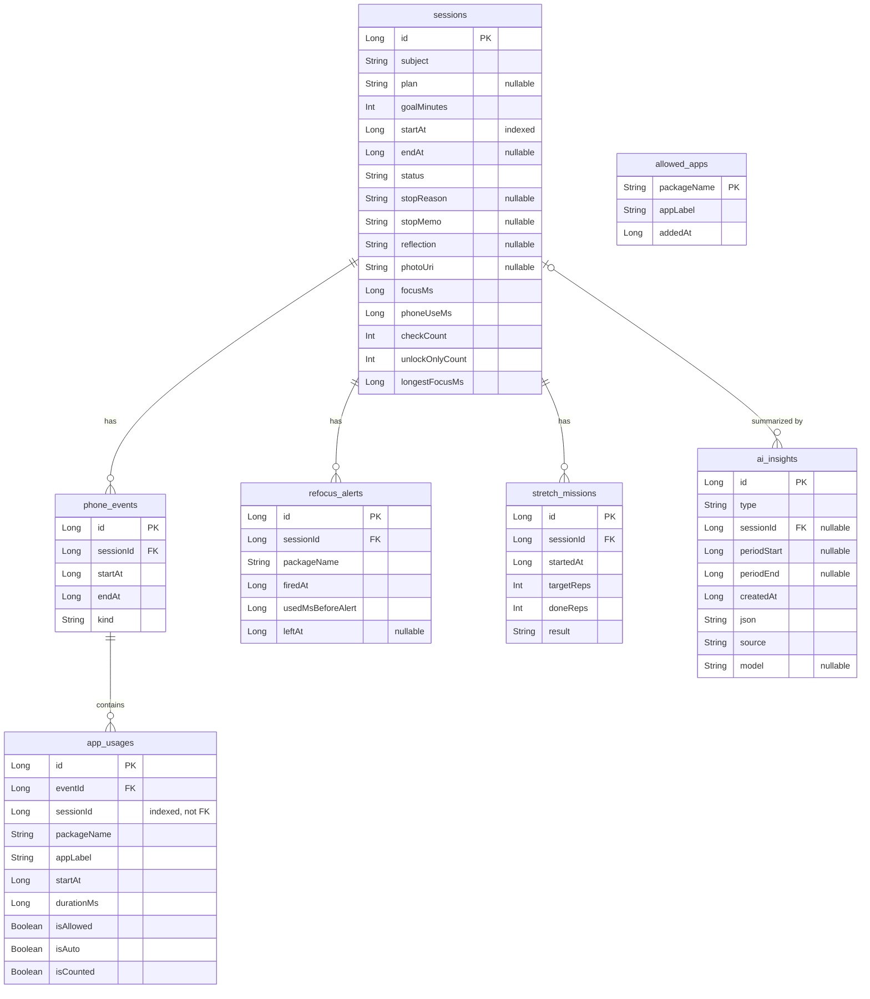

# FocusTrace — Room Schema

Owner: track A. Change entities only after updating this file.

## Conventions
- Times: `Long` epoch ms. Durations: `...Ms`. Status/kind values: `String`.
- Day/week/month boundaries are computed in the device time zone.
- Child rows are deleted with their session (`onDelete = CASCADE`). Index every foreign key and `sessions.startAt`.

## ER diagram

## Tables

### `sessions` — one focus session
| Column | Type | Note |
| --- | --- | --- |
| `id` | Long PK auto | |
| `subject` | String | |
| `plan` | String? | one-line plan |
| `goalMinutes` | Int | |
| `startAt` | Long | |
| `endAt` | Long? | null while running |
| `status` | String | `RUNNING` / `COMPLETED` / `EARLY_STOP` / `INTERRUPTED` |
| `stopReason` | String? | Early Stop reason code (B) |
| `stopMemo` | String? | |
| `reflection` | String? | wrap-up note |
| `photoUri` | String? | app-private storage (C) |
| `focusMs` | Long | summary, set by `endSession()` |
| `phoneUseMs` | Long | summary |
| `checkCount` | Int | summary |
| `unlockOnlyCount` | Int | summary |
| `longestFocusMs` | Long | summary |

Summary columns stay 0 while `RUNNING`. For live values of a running session (e.g. widget), count its `phone_events` directly.

### `phone_events` — one episode (unlock → screen off)
| Column | Type | Note |
| --- | --- | --- |
| `id` | Long PK auto | |
| `sessionId` | Long FK | |
| `startAt` | Long | `USER_PRESENT` time (or session start) |
| `endAt` | Long | screen off |
| `kind` | String | `CHECK` / `ALLOWED_ONLY` / `UNLOCK_ONLY` |

### `app_usages` — one app inside an episode
| Column | Type | Note |
| --- | --- | --- |
| `id` | Long PK auto | |
| `eventId` | Long FK | |
| `sessionId` | Long | for direct queries |
| `packageName` | String | |
| `appLabel` | String | name at save time |
| `startAt` | Long | clipped to unlock time |
| `durationMs` | Long | consecutive same app merged |
| `isAllowed` | Boolean | allow-list state at save time |
| `isAuto` | Boolean | reappeared on unlock |
| `isCounted` | Boolean | false = pass |

### `allowed_apps`
| Column | Type |
| --- | --- |
| `packageName` | String PK |
| `appLabel` | String |
| `addedAt` | Long |

### `refocus_alerts` — refocus notification (F-13)
| Column | Type | Note |
| --- | --- | --- |
| `id` | Long PK auto | |
| `sessionId` | Long FK | |
| `packageName` | String | |
| `firedAt` | Long | |
| `usedMsBeforeAlert` | Long | |
| `leftAt` | Long? | when the user left that app |

### `stretch_missions` — stretching mission (F-12, owner B)
| Column | Type | Note |
| --- | --- | --- |
| `id` | Long PK auto | |
| `sessionId` | Long FK | |
| `startedAt` | Long | |
| `targetReps` | Int | default 10 |
| `doneReps` | Int | |
| `result` | String | `COMPLETED` / `SKIPPED` / `FAILED` |

### `ai_insights` — AI result cache (owner B)
| Column | Type | Note |
| --- | --- | --- |
| `id` | Long PK auto | |
| `type` | String | `INSIGHT_4W` / `SESSION_SUMMARY` / `HOME_RECO` / `TIME_SUGGESTION` |
| `sessionId` | Long? FK | only for `SESSION_SUMMARY` |
| `periodStart` | Long? | |
| `periodEnd` | Long? | |
| `createdAt` | Long | once-a-day cache check |
| `json` | String | validated result |
| `source` | String | `AI` / `RULE_FALLBACK` |
| `model` | String? | |

AI consent is a setting (DataStore), not a table.

## Calculations
| Value | Rule |
| --- | --- |
| `phoneUseMs` | sum of `durationMs` where `isCounted` and not `isAllowed` |
| `focusMs` | (`endAt` − `startAt`) − `phoneUseMs` |
| `checkCount` | episodes with `kind = CHECK` |
| `longestFocusMs` | longest gap between session start, `CHECK` episodes, and session end |
| checks per focus hour | `SUM(checkCount) / SUM(focusMs) × 3,600,000` |

## Session API (track A)
| Function | Purpose |
| --- | --- |
| `startSession(subject, plan, goalMinutes)` → `sessionId` | insert session, start `FocusService` |
| `endSession(sessionId, status, stopReason?, stopMemo?)` | stop service, close open episode, write summary |
| `observeRunningSession()` → `Flow<Session?>` | running session or null |
| `observeSession(sessionId)` → `Flow<SessionDetail>` | session + episodes + app usages |
| `getAllowedApps()` / `setAllowed(packageName, allowed)` | allow list |
| `recoverInterruptedSessions()` | on app start, close `RUNNING` sessions as `INTERRUPTED` |

Report queries (track B) may live in a separate DAO.
